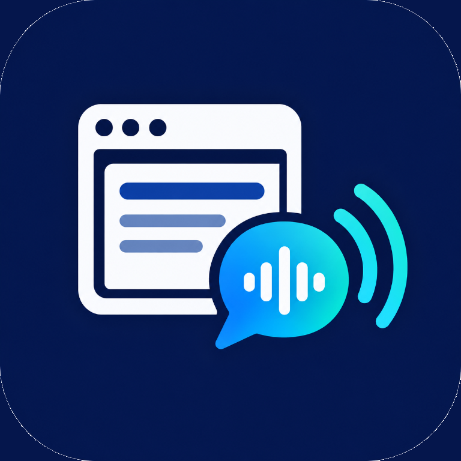

# AHCI-PageSpeak
PageSpeak is a project built to bridge the gap between vocal commands and web page browsing through the integration of VUI and GUI controls. This currently runs on Google Chrome, but the realistic limitation is on the browser's audio input constraints.

## Local LLM command interpretation

The VUI implementation keeps its rule-based command parser as the fast path. If a transcript is not recognized, it sends the transcript and a limited list of visible interactive element names to Ollama running on the same computer. The model response is validated against the supported command actions before execution.
# PageSpeak

<p align="center">
  
</p>

<p align="center"><strong>Voice-first webpage navigation any browser</strong></p>

PageSpeak combines a voice user interface (VUI) with an on-page graphical user interface (GUI) to make webpages easier to browse. Speak a command to scroll, read, click, focus, type, search, or navigate. The extension can also place numbered labels on visible links, buttons, and form fields so you can reach them by voice.

## What is included

- Chrome extension with a floating voice-control panel.
- Browser speech recognition and text-to-speech.
- Rule-based command parsing for fast, predictable commands.
- Optional local Ollama interpretation for more conversational wording.
- Numbered on-page labels and visual highlights.
- Local usage logging for evaluation and user studies.

## Requirements

- Google Chrome or another browser.
- A copy of this repository.
- A microphone for voice commands.
- Ollama is optional. The rule-based commands work without it.

## Install and run

### 1. Get the project

Clone the repository or download it. Then open PowerShell in the project folder. If you cloned it with Git, use:

```powershell
git clone https://github.com/Lotusey/AHCI-PageSpeak.git
cd AHCI-PageSpeak
```

If you downloaded a ZIP file, extract it, open PowerShell in the extracted project folder, and skip the `git clone` command. The folder you select later must contain `manifest.json`.

### 2. Load the extension in Chrome

1. Open `chrome://extensions`.
2. Turn on **Developer mode**.
3. Click **Load unpacked**.
4. Select the extracted or cloned project folder—the folder containing `manifest.json`:

   ```text
   <your-project-folder>\AHCI-PageSpeak
   ```

5. Open any normal `http://` or `https://` webpage. The **Voice Web Navigation** panel appears in the bottom-right corner.
6. Click **Listen** and allow microphone access when Chrome asks.

After pulling new changes, click the reload icon on the extension card and reload any open webpages.

### 3. Optional: enable conversational commands with Ollama

The rule-based parser is the default fast path. Ollama is only needed when PageSpeak must interpret wording that does not match one of the built-in command patterns.

To make sure this all runs correctly, perform the following commmands:

1. Install Ollama at `https://ollama.com/download` with your respective operating system.

2. Download the configured model once in PowerShell:

	powershell:
	`ollama pull llama3.2:3b`

3. In Chrome, open `chrome://extensions`, enable Developer mode, choose **Load unpacked**, and select the `VUI_Implementation` folder (that contains the manifest file as well). Copy the extension ID shown on its card.

4. Ollama must allow this extension's origin. In Windows, open **Edit environment variables for your account** and add a user variable named `OLLAMA_ORIGINS` with this value, replacing the placeholder with the copied extension ID:

	text:
	`chrome-extension://YOUR_EXTENSION_ID`

5. Quit Ollama from its system-tray menu (force quit) and reopen it so the environment setting takes effect. Ollama for Windows normally runs in the background; do not start a second `ollama serve` process if it is already running.

Ollama inference uses `http://127.0.0.1:11434` and does not require a paid model API. The current speech transcription still uses the browser's Web Speech API, whose recognition may be provided by a browser service; local Ollama only guarantees that command interpretation stays on-device. The model can be changed in `VUI_Implementation/src/background.js`.

Open Google Chrome and access any website. The GUI will appear in the bottom right corner, and you can begin to start using it by clicking the `Listen` button.